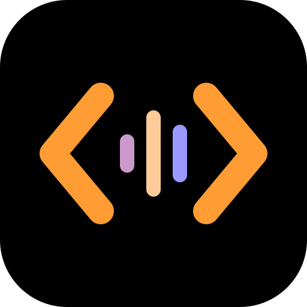

# Picard Code

**A voice-only tribute to Sir Patrick Stewart and Captain Jean-Luc Picard.**

Say "Computer", give your order, and hear a calm spoken answer while the
details appear on screen. You are Captain Picard. Ask questions, write,
research, plan, or work on code with OpenCode 2 and any AI provider it supports.
There is no typing; the app is made for a desktop browser.

Listening (Nemotron) and speaking (Kokoro) run on your computer by default.
Call on Riker, Data, Geordi, Worf, Troi or Crusher for their expertise, with
ready-made voices, not performer clones.

[Watch the short video](https://youtu.be/_OKnpwS9dOI) ·
[Project website](https://sbroenne.github.io/picard-code/) ·
[User guide](https://github.com/sbroenne/picard-code/blob/main/docs/USER_GUIDE.md)

## Get started

You need **Node.js 24 or newer** (an LTS release), a microphone, speakers or
headphones, and an AI provider supported by OpenCode. A few free models are
available through OpenCode without signing in.

For default local speech, allow **2 GB of free disk space** and use an Apple
silicon Mac with macOS 14 or newer, Windows x64 or ARM, or Linux x64 or arm64
with glibc 2.31 or newer. Windows ARM uses compatibility support; Nemotron
has not yet been checked on a Windows ARM machine. Intel Macs and other
supported computers can use your own Azure speech resource under
**Advanced setup**. See the
[full requirements](https://github.com/sbroenne/picard-code/blob/main/docs/USER_GUIDE.md#get-started).

Open a terminal in your project folder and run:

```sh
npx picard-code
```

Your browser opens for the current project folder. Choose **Begin start-up**,
connect your AI provider, confirm an AI model and open a channel. Existing
OpenCode sign-ins and your chosen default model can skip those steps.
Local speech downloads automatically, with progress and any real errors shown.
OpenCode 2 is included if you do not already have it; Python and speech
packages are prepared for you.

Keep the terminal open. Press **Ctrl+C** to stop.

## Give an order

- "Computer, what can you do?"
- "Computer, Data, explain this project. Do not change any files."
- "Computer, ask Geordi to investigate this failure."
- "Computer, Number One, what are our options?"
- "Computer, new log entry."

Follow-ups stay in the Current log entry and need no "Computer" prefix.
Say **"Stop listening"** to return to Standing by; the next "Computer"
continues that entry. **"Belay that"** stops running work. Switch the
microphone off to stop hearing the room.

## Your data and approvals

The interface runs locally, but an online AI provider receives requests and
relevant project content. Local speech processes audio on your computer;
optional Azure speech sends audio or reply text to your Azure resource.
Downloads and settings stay in `~/.picard-code`, not your project.

**OpenCode's permission rules apply. By default, OpenCode 2 can change files
and run commands without asking.** Configure its permissions if you want
approval first. When an approval is requested, choose **Allow once** or
**Deny** on screen; voice cannot grant it.
[Read about permissions and privacy](https://github.com/sbroenne/picard-code/blob/main/docs/USER_GUIDE.md#spoken-requests).

## Advanced

### Run from source

With Git and Node.js installed:

```sh
git clone https://github.com/sbroenne/picard-code.git
cd picard-code
npm install
npm run build
npm start
```

Choose your own project with the **Project** tile.
[More about running from source](https://github.com/sbroenne/picard-code/blob/main/docs/USER_GUIDE.md#run-from-source).

### Choose another project

Picard Code uses the terminal's current folder by default. To launch from
somewhere else and select a different project:

```sh
npx picard-code --project "full path to your project"
```

You can also change the folder with the **Project** tile in the app.

## Guides and help

[The user guide](https://github.com/sbroenne/picard-code/blob/main/docs/USER_GUIDE.md)
covers provider sign-in, bridge crew, spoken controls, local and Azure speech,
saved settings and troubleshooting.

- [Setup and support](https://github.com/sbroenne/picard-code/blob/main/SUPPORT.md)
- [Help shape the computer](https://github.com/sbroenne/picard-code/blob/main/CONTRIBUTING.md)
- [Developer guide](https://github.com/sbroenne/picard-code/blob/main/docs/DEVELOPMENT.md)
- [Discussions](https://github.com/sbroenne/picard-code/discussions)

This is an unofficial tribute, with original artwork and wording, no copied
show dialogue or cloned voices, and no endorsement.
[MIT license](https://github.com/sbroenne/picard-code/blob/main/LICENSE) ·
[Third-party notices](https://github.com/sbroenne/picard-code/blob/main/THIRD_PARTY_NOTICES.md)
