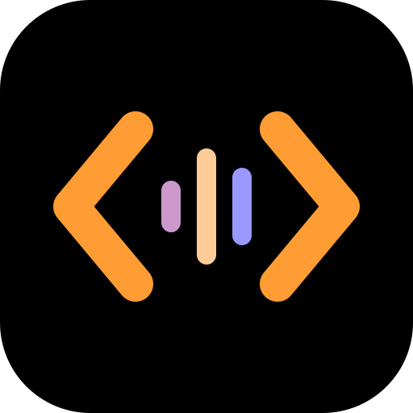
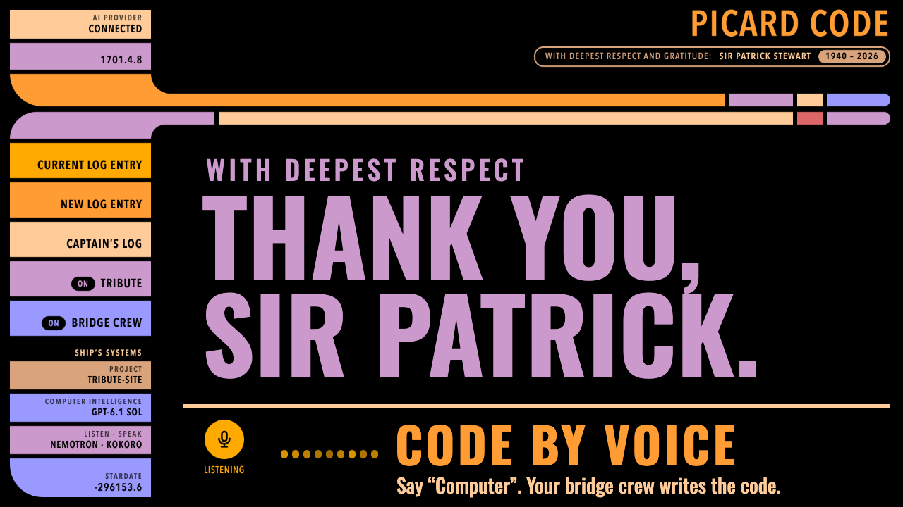

# Picard Code user guide

[Back to Picard Code](../README.md)

**A tribute to Sir Patrick Stewart and Captain Jean-Luc Picard.**

*With deepest respect and gratitude: Sir Patrick Stewart, 1940 – 2026.*

Picard Code lets you work the way the captain did: you speak, and the ship's
computer answers. Say "Computer", give the order, and it replies briefly and
calmly while the details appear on screen. You are always addressed as Captain
Picard; your lines are labeled "Picard", and the computer may sometimes call
you "Captain". There is no typing: like the captain, you speak to the computer.

It is unofficial and made with admiration: original artwork in the spirit of
the ship's displays, no franchise material, and no endorsement.

The computer handles general questions, writing, research and planning as well
as code. A project folder is context for project work, not a limit on what you
can ask.

[](https://youtu.be/pFGjNWeaHJI)

[Help shape the computer](../CONTRIBUTING.md) ·
[Setup and support](../SUPPORT.md) · [MIT license](../LICENSE)

The [project website](https://sbroenne.github.io/picard-code/) is a separate
static tribute page, published from `site/` with GitHub Pages. It does not run
the app or listen to visitors.

## Contributions welcome

The most valuable contributions are **computer character development** and
**more listening and speaking models**, especially local choices. Help the
computer stay calm, precise, useful, and recognizably part of this tribute:
original wording, better follow-ups, pronunciation, and comfortable timing,
not copied dialogue or cloned performer voices.

We also welcome accessible desktop controls, testing with other accents,
rooms and microphones, Linux setup, and reliability improvements. Read
[CONTRIBUTING.md](../CONTRIBUTING.md) for the project's direction and checks.
Bring open-ended ideas to [Discussions](https://github.com/sbroenne/picard-code/discussions);
use the [issue forms](https://github.com/sbroenne/picard-code/issues/new/choose)
for bugs and proposals.

This is an early project. The app is voice-only and designed for a computer
screen.

### How it works

A small local browser app. OpenCode does the coding, with any model provider it
supports, and keeps every log entry in Captain's log. While the computer is listening,
say "Computer" to address it. Follow-ups need no prefix until you return to
Standing by; the next addressed request continues the Current log entry.
By default, listening (Nemotron) and speaking (Kokoro) run on this computer,
with no cloud account. Your own Azure MAI resource can be chosen instead, for
either side or both, under **Advanced setup**. Saved Whisper listening choices
are upgraded to Nemotron automatically; the speaking choice stays the same.

## Get started

You need:

- **Node.js 24 or newer**, using a long-term support (LTS) version such as 24 or 26. It includes npm and npx.
- A microphone, and speakers or headphones.
- A model provider OpenCode can use (see
  [Connect a model provider](#connect-a-model-provider)).
- For the default Nemotron and Kokoro speech, one of these computers. Allow **2 GB**
  of free disk space for the default Nemotron and Kokoro setup:
  - an Apple silicon Mac with macOS 14 or newer;
  - Windows on an x64 or ARM processor (ARM uses Intel-compatible Python
    through Windows' built-in emulation);
  - Linux on an x64 or arm64 processor, with glibc 2.31 or newer.

  Intel Macs are not supported.

  Nemotron's Linux runtime needs glibc 2.31 or newer. Windows ARM uses the Intel-compatible
  Nemotron runtime; the owner has checked Nemotron on a Windows ARM machine.
  That check does not establish that every Windows ARM machine works.
  All choices need local pause detection: macOS 14 or newer, Windows, or Linux with glibc 2.28 or
  newer, on an x64 or arm64 processor. Preparation installs its Python
  packages automatically.

Then, in a terminal:

```sh
npx picard-code
```

This starts Picard Code for the current folder. The first time, npx downloads
Picard Code and a copy of the official OpenCode 2
(about 230 MB). If OpenCode 2 is already installed, Picard Code uses yours
instead. You do not need to install OpenCode, Python or anything else
yourself. OpenCode 1 is not supported.

Prefer to keep a local copy of the source instead of using npx? Follow
[Run from source](#run-from-source) below. Both ways open the same app and
use the same first-run setup.

The first time, the ship comes online one system at a time. The welcome
screen shows three systems and which are already online; choose
**Begin start-up**:

1. **Computer core**: your own AI account, such as GitHub Copilot, Anthropic
   or OpenAI, used through OpenCode. If OpenCode is not signed in, the screen
   gives the sign-in order with **Copy order**. Run it in a terminal; when you
   return to the page, the computer core comes online by itself. A link lets
   you skip sign-in and use OpenCode's few free models instead.
2. **Computer intelligence**: the AI model. If you set a default model in
   OpenCode, **Begin start-up** uses it and this step is skipped. Otherwise
   choose one and **Confirm this model**. For the best experience, choose the
   most capable model your provider offers; it may cost more or take longer.
3. **Communications**: choose **Open a channel** to check microphone access
   and allow it if the browser asks. On macOS, Windows and Linux, a failed
   check keeps this step open with the actual error and steps to try.
   Connect a microphone or update its permissions, then choose **Open a channel**
   again; you do not need to restart Picard Code.

Steps already finished in OpenCode are skipped. Meanwhile the voice systems
prepare on their own: a bar at the bottom of the screen shows each real step
of the one-time local Nemotron and Kokoro download, or the real error with
**Try again** (see [Local speech setup](#local-nemotron-and-kokoro-setup)).
**Open a channel** is available once they are online. Then give your first
order, such as "Computer, what can you do?". After the first answer, the
senior officers report, unless the Bridge crew switch is off; choose
**Dismissed** or simply give your next order. Change any of these later
from the side panel tiles.

Picard Code does not rank models or choose one for you. It only uses a default
model you set in OpenCode yourself, never one OpenCode picked on its own.
Your confirmed model is remembered on this computer, across restarts, browsers
and project folders, without changing OpenCode's default. If that model
becomes unavailable, choose and confirm another; Picard Code never substitutes
a model.

Existing users without speech set up see **Prepare the computer** instead,
which runs the same download. Later starts use your saved speech choices.
The microphone starts automatically on later starts. While it starts, the
console says **Not listening** and the label under the microphone says
**Starting**; allow access if your browser asks.
After microphone access is allowed, Picard Code tries to resume browser audio
again so an earlier block does not leave listening paused. If the browser still
requires a page interaction, choose **Resume listening** or press **M**.
Whenever the computer cannot hear you, the console says **Not listening** and
the line below it says why. The microphone button is the only control: when a
click lets the computer hear, the button grows with an orange ring. If the
browser paused sound, the label says **Paused**; click the microphone or press
**M** to resume, without switching it off and back on. If the microphone is
off, the label says **Microphone off**; click it or press **M**.
Once the computer can hear, the console says **Standing by**, the label says
**Listening**, and the centre of an empty log entry reads **Please specify your request.**
If you choose [Azure speech](#azure-speech-setup) for both listening and
speaking, setup prepares only the small local pause detector and its Python
packages, not Nemotron or Kokoro. Speech choices are separate from the model
provider OpenCode uses.

Your browser opens automatically. Keep the terminal open; press **Ctrl+C** to
stop Picard Code and the OpenCode server it started. Use `--no-open` to print
the address without opening a browser, and `npx picard-code --help` for all
options.

To choose a different project folder:

```sh
npx picard-code --project "full path to your project"
```

Windows example:

```powershell
npx picard-code --project "C:\Users\you\source\my-project"
```

macOS or Linux example:

```sh
npx picard-code --project "$HOME/projects/my-project"
```

You can also change the folder with the **Project** tile in the side panel.
Stop running work first.
The folder is passed to OpenCode for every log entry and request.

### What stays on your computer

Everything Picard Code downloads or saves is kept in one folder,
`.picard-code` in your home folder (on Windows, `C:\Users\you\.picard-code`):

- `speech.json`: your speech settings (no keys or passwords);
- `model.json`: the provider and model you explicitly confirmed (no keys or passwords);
- `voice`: local speech and its Python environment;
- `uv` and `python`: only if uv was not already installed, the uv that set up speech and its Python;
- `sounds`: the computer sounds, downloaded at the first start.

Nothing is written into your project. To remove everything, delete that
folder. OpenCode keeps its own sign-ins and log entries; see
[OpenCode's documentation](https://opencode.ai/v2/docs/). npx keeps Picard
Code itself in npm's cache; `npx picard-code@latest` gets the newest version.

## Run from source

As an alternative to `npx picard-code`, you can download the repository,
build it and run your local copy. You need **Git** as well as Node.js 24 or
newer. Open a terminal and run:

```sh
git clone https://github.com/sbroenne/picard-code.git
cd picard-code
npm start
```

`npm start` installs the needed packages and builds the app before launching.
If either step fails, it shows the error and does not launch the app.

Your browser opens automatically. Keep the terminal open while using Picard
Code; press **Ctrl+C** to stop it. Choose **Begin start-up** and bring the
ship's systems online as described in [Get started](#get-started); local
listening and speaking prepare on their own. You need a microphone and
speakers or headphones.

Starting from this folder selects the Picard Code repository as the Project.
Use the **Project** tile in the app to choose the folder you want to work on.

For later starts, open a terminal in your `picard-code` folder and run
`npm start` again. It checks the packages and builds again each time,
including after you update the source.

Choose speech in the app as described in [Get started](#get-started).
For changing Picard Code itself, see the
[developer guide](DEVELOPMENT.md) and [contribution guide](../CONTRIBUTING.md).

## Bridge crew

You remain Captain Picard. Six OpenCode officers bring different expertise:
Riker weighs options and recommends, Data investigates, Geordi builds and
repairs, Worf reviews risks, Troi reviews clarity and usability, and Crusher
checks software health and recovery. The computer remains a separate interface.

Each officer speaks in their own TNG voice, as a Starfleet officer reporting to
the Captain: Riker is confident and gives firm recommendations, Data is exact
and never uses contractions, Geordi is friendly and practical, Worf uses few,
grave words, Troi is calm and asks gentle questions, and Crusher is direct and
may call you "Jean-Luc" when she disagrees. They say "Captain" or "sir", and
"Aye, sir." only when actually carrying out an order. There is no copied
dialogue, no famous scenes or running jokes, and no cloned voices. They
can contribute to non-code work too; the computer keeps its restrained, neutral
manner. [docs/research/bridge-crew-voices.md](research/bridge-crew-voices.md)
explains the choices.

Start with **Computer**, as before. Officers answer to their bridge names:
"Number One" or "Will", "Mr. Data", "Mr. La Forge" or "Geordi", "Mr. Worf",
"Counselor" or "Deanna", "Doctor" or "Beverly". For example:

- "Computer, Data, explain this project."
- "Computer, ask Geordi to investigate this failure. Do not change any files."
- "Computer, Number One, should we split this change in two?"
- "Computer, Worf and Data, review this change."
- "Computer, Counselor, review this invitation for clarity."
- "Computer, help me plan a visit to a museum."

The computer and the officers also understand the Captain's orders:

- **"Make it so"** (or "proceed") carries out exactly what was just proposed in
  that log entry, and nothing more. After an officer's proposal, it goes back to
  that officer. If nothing was proposed, or it is unclear which proposal you
  mean, you are asked one short question.
- **"Engage"** starts the agreed work now.
- **"Report"** gives what is done, under way and failed; **"Options"** gives two
  or three choices with a recommendation first; **"On screen"** shows it on screen.

When a question from OpenCode is waiting with exactly one plain yes answer
(such as "Yes" or "Proceed"), saying "Make it so" or "Engage" chooses it.
Approvals are never answered by voice, including by these orders.

You do not have to name an officer. When you don't, Picard Code first asks the
selected model, in a quick separate check, who should handle the request, and
then hands it over itself. This check adds nothing to the log entry, usually
takes a second or two, and makes one small extra model request. If it fails,
the request is not sent and the computer says the real error, which also stays
on screen.

As on the Enterprise, the computer answers most requests itself: facts,
look-ups, explanations, news, research, summaries, writing, finding things in
the project, small or clear changes, small talk, questions about Picard Code,
and questions about the Captain or Sir Patrick Stewart. An officer takes a
request only when it needs a substantial expert judgment in their area:

- Riker: options and recommendations on a real decision.
- Data: careful technical analysis.
- Geordi: investigating failures and repairs.
- Worf: security, safety and privacy.
- Troi: how people will read or feel about something.
- Crusher: health and wellbeing.

That officer answers you directly in the log entry, just as if you had named
them. A briefing with several officers happens only when you ask for options,
a recommendation or a briefing, or name several officers. The check
also recognises common mishearings, such as "Rika" for Riker or "Walt" for
Worf, and sends a follow-up such as "Make it so" back to the officer who just
answered.

The officers do not know about events after their own fictional deaths,
not the actors' deaths. They say they do not know rather than answer from
later accounts or lookups, even after a return from death. This is not a
TNG-only cutoff: Star Trek: Picard is included. The computer's answers are
unchanged.

An explicit officer address or list of officers at the start selects them
directly, without the check; mentioning Data or saying "do not ask Data" does not.

You lead the briefing, as Picard does on the bridge. The computer connects the
officers the work needs, usually two or three, never the whole crew by default.
They report directly to you and may disagree or offer alternatives. Riker gives
his judgment when needed; he does not automatically speak last or ask whether
to proceed. You decide. "Make it so" carries out the clear proposal you just
discussed, within its limits; if the choice is unclear, the officer asks.

If you explicitly ask Number One to organise or coordinate work, he can call
the relevant officers and base his recommendation on their actual findings.
An opinion or recommendation alone does not authorise him to hand work on.
Other officers name any additional expertise needed so you can call that
colleague. OpenCode's existing helper limit and approval rules still apply;
at most one officer may change files, and only when you requested changes.
Each officer called makes an extra model request and can increase cost.
Full reports stay on screen. If the computer only copies a report word for
word, the copy is not shown.

Reports are labelled by officer inside the same Current log entry; there is no
separate crew display. Related approvals and questions appear there too, naming
the officer. Approvals still require
**Allow once** or **Deny** on screen. **Belay that** asks OpenCode to stop both
the main entry and its related crew work. Running crew work also prevents
deleting that entry or changing projects.

The **Bridge crew** switch in the left navigation brings the officers on or off
duty, and is remembered in this browser. When it is off, the computer answers
every request itself, including requests that name an officer and follow-ups
in an officer's log entry. Work already running continues until it finishes or
you say **Belay that**. If the crew cannot be loaded (see below), the computer
also answers everything itself, and naming an officer reports why.

Everyone uses the selected model and speech service. Each officer has their
own ready-made Kokoro and Azure MAI voice, measured to sound closer to the
actor; nothing is cloned. An officer's answer is spoken in their voice. After a
briefing, each officer gives their complete conversational answer in report
order, without a fixed closing speaker or a question repeated at the end.
Stories and explanations are spoken across paragraphs, not just the first.
Code, tables, source links and lengthy technical detail stay in an **On screen**
section. An answer can contain up to 8,000 spoken characters across its speakers;
longer answers report a speech error rather than silently cutting off the text.
Routine computer receipts stay on screen; real failures are still spoken.
When Riker was explicitly asked to coordinate, his own reply follows the
reports he requested. Spoken
replies appear on screen when the voice starts saying them, so you hear the
answer first and read the detail alongside it. If you stop speaking, switch
the microphone off, or the voice fails, the reply is shown without waiting.
It also appears after 20 seconds if the voice has not started. There is no
lasting shared crew memory or automatic issue watching.

When Picard Code starts its own OpenCode server, it loads the crew from a
temporary settings file outside your project and removes it on
normal shutdown. That file adds the crew without replacing OpenCode's normal
global settings or MCP connections. Each officer receives the current coding agent's effective
permission rules unchanged, including project-specific rules. Changing projects
or refreshing the connection refreshes those rules. No crew settings, agent
files or team memory are added to your project or global settings.
These temporary crew definitions are separate from your saved speech settings
in `~/.picard-code/speech.json`.

If `OPENCODE_CONFIG` is already set, Picard Code preserves that file and the
normal global settings, but cannot add its temporary crew file. To use the crew,
keep your settings in a folder selected with `OPENCODE_CONFIG_DIR` and leave
`OPENCODE_CONFIG` unset. Settings that override the reserved `picard-` agents are reported rather
than bypassed. In both cases Picard Code still starts: the terminal explains
why the crew is unavailable, and the computer answers every request itself.

## Connect a model provider

Picard Code works with any model provider OpenCode supports: GitHub Copilot,
Anthropic, OpenAI, Azure OpenAI, models on your own computer, and many more
(see [OpenCode's providers](https://opencode.ai/v2/docs/providers/)). It uses
the sign-ins OpenCode already has and does not copy credentials from `gh`,
your browser or another tool. OpenCode also offers a few free models of its own
without any sign-in; they appear in the list under **OpenCode**.

To sign in to a provider:

1. In another terminal, run `npx picard-code opencode auth login` (or
   `opencode auth login` if you installed OpenCode yourself).
2. Choose your provider from the list and follow its sign-in. For GitHub
   Copilot, that is GitHub's device sign-in: check you are signed in to the
   right account, enter the code OpenCode shows, and approve it yourself.
3. Return to Picard Code. During the first start-up, the computer core
   comes online as soon as you return to the page. Later, choose the
   **AI provider** tile and then **Refresh connection**. Models are grouped
   by provider: pick one and choose **Confirm this model** during start-up,
   or **Use this model** in the **Computer intelligence** tile later.
   Changing the list alone does not save or activate a choice.

The start-up does not ask you to sign in again when OpenCode already has a
connected provider, and a saved model choice means the start-up does not
appear again.
You can add providers later through **Connect an AI provider** in Computer
intelligence. Local providers remain supported without an online account.
A provider with no available models opens Computer intelligence so you can
check OpenCode's model settings and refresh, rather than being sent through
sign-in again. Supporting explanations,
including OpenCode's permission behavior, are under **About the connection**.

Computer intelligence labels the selector **AI model** and shows **Model saved**
after confirmation. First-time guidance recommends a capable model; saved
choices and recovery have their own wording rather than repeating the welcome.
**Use this model** stays off until you choose a different model. Later changes
use Ship's systems drawers; there is no extra confirmation screen. **About this choice**
explains where the choice is remembered; if the saved model is unavailable,
**Refresh connection** is offered in the same panel.

Choose the most capable model your provider offers for the best experience.
More capable models may cost more or take longer to answer. Picard Code does
not rank the models or select OpenCode's default for you.

`npx picard-code opencode auth list` shows which providers are signed in.

## MCP servers and sign-in

MCP servers give OpenCode tools and access to other services. Picard Code uses
the servers configured in OpenCode; it does not maintain a separate server
list or credential store. Open **MCP servers** under **Ship's systems** for
the current server list and connection actions.
The tile shows a live connection count or what needs attention, without opening
the panel. The panel puts server names, states and actions first; terminal
commands and explanations stay in this guide, reached through **Setup help**. Choose **Error details**
beside a server to read its actual error.
The list shows connected servers, servers needing sign-in, disabled servers,
connections still starting, and failed connections.
It updates when OpenCode reports a connection change and checks again whenever
you open the panel. A failed lookup is shown as an error, never an empty list.
MCP setup is optional, not part of first start-up.

Choose **Sign in** beside a server to open its own sign-in page through
OpenCode. Finish there and return; the list and tile update from the real
connection state. If the browser blocks the tab, choose **Continue sign-in**.
Choose **Retry** to retry a failed connection. These actions do not enable
servers you disabled or change your saved configuration.

Some services need a sign-in code, extra fields or an API key that must be
handled directly in OpenCode. The panel explains when this is needed; open
**Setup help** for the commands. Picard Code never asks you to type credentials.

In another terminal, open the selected **Project** folder. The **Project** tile
shows its full folder path.
This selects the project's settings; it does not install OpenCode there.
If this launch uses custom OpenCode settings, use the same settings and
environment variables in that terminal. Check the configured servers:

```sh
npx picard-code opencode mcp list
```

For a remote server that needs sign-in:

```sh
npx picard-code opencode mcp auth
```

Choose the server and follow OpenCode's sign-in. Picard Code prefers an
installed OpenCode 2 and uses its bundled copy only when no suitable
installation is found; `PICARD_OPENCODE_PATH` can explicitly select a copy.
Picard Code starts and stops OpenCode for you, using your existing global and
project settings. You do not need to start OpenCode separately.
OpenCode stores the sign-in, not Picard Code. Never speak
passwords, keys or sign-in codes, or put them in a log entry.

Return to the panel and choose **Refresh connections** after configuration changes, while no
work is running. This reloads OpenCode's settings without starting a new log
entry or changing your confirmed AI model. Refresh success means the settings
were reloaded, not that every server connected. The list is checked again to show
the actual connection results and errors for the selected Project. If your AI model becomes unavailable,
the existing model-recovery screen still asks you to choose a replacement.

Adding and configuring servers is advanced OpenCode setup. Read
[OpenCode's MCP guide](https://opencode.ai/v2/docs/mcp-servers/), or run
`npx picard-code opencode mcp add --help`. OpenCode's add command normally
writes project configuration; use `--global` to keep it outside the project
and make it available across Projects. Picard Code does not add or edit these
files for you. Servers needing an API key must be configured in OpenCode;
keep keys out of project files. Use environment-variable references as
described in its guide, and restart the server if you change its environment.

Connect only services you trust. A service may receive data when its tools
are used. OpenCode's permission rules still apply: signing in does not grant
a pending approval, and voice cannot approve one.

## The main screen and Ship’s systems

The main screen shows only the current log entry: the messages, any
question or approval waiting for you, and the computer console with one large
activity (Standing by, Accessing or Transmitting) and a line saying what to do
next. **Transmitting** means the computer is speaking its reply, not sending your
request. **Decision needed** and **Answer needed** take priority when a response
is required. A separate label under the microphone shows **Starting**,
**Listening**, **Microphone off** or **Paused**, so you can still see
whether the microphone is enabled while the computer works or speaks.
The console also holds
**Stop speaking** and **Belay that** when they apply, and the microphone
button; the row of lights beside it shows listening, and turns blue and moves
while work runs. While the request runs, a line at the end of the log entry
also says so and who is on it, such as "Data is working on it.", with what is
happening now when OpenCode reports it, such as "Searching the web.", and a
moving LCARS scanning bar. They show only while OpenCode reports the work as
running; the bar never replaces the written progress. If a step fails along the way
but the request carries on, such as a web page that refuses access, it is
folded into a small "1 step did not work" note; open it to read the exact
error. A reply that ends without an answer still shows its errors in full.
A real failure shows in a red alert frame and a question or approval waiting
for you in a yellow alert frame; the error text inside stays exact, and screen
readers hear only that text. Each officer's reply shows their rank pips and
uniform colour: command red for Riker, operations gold for Data, Geordi and
Worf, and sciences blue for Troi and Crusher. The log entry opens with
"Captain’s log, stardate …".
The latest request and reply are shown large; earlier messages are smaller. The header shows only the name and the
tribute badge. Like the ship's computer, there are no entry names or
modes on the main screen.

Everything else is hidden in slide-outs, opened from the side panel.
The **Tribute** tile stays in the left navigation, with a clear **On / Off**
state and no visible checkbox. Click the tile or use Space while it is focused.
It starts on and is the
only on/off control for tribute extras; there are no switches inside answers.
The **Current log entry** tile at the top is lit while the current log entry is in
front; choosing it brings it back. Choosing the same tile again,
clicking the log entry beside the slide-out, or the Escape key also closes it. Picard Code is made for a computer
screen; there is no phone layout.

- **Stardate**: the last tile shows today's stardate, using the common fan
  formula 1000 × (year − 2323) plus the part of the year gone by, so today's
  dates are negative. Dates and times are always given as stardates: on screen, and
  when the computer answers ("what time is it?" gets the current stardate),
  since each request tells it the current stardate.
- **Captain’s log** (`#records`): earlier log entries in the project folder (latest
  100), grouped by whole stardate with the latest first, each marked with the
  stardate it was started. Choose one to reopen it. The ✕ beside an entry deletes it from OpenCode
  permanently, after you confirm; an entry that is still working cannot be
  deleted until it is stopped.
- **Ship’s systems** (`#settings/…`): there is no Settings button. Each tile in the
  side panel opens its own part of the ship’s systems, with a short LCARS panel
  code (SYS 01 to SYS 06): **AI provider** the sign-in steps,
  **Computer intelligence** the AI model, **Project** the folder,
  **Listen · Speak** the speech services, **MCP servers** the OpenCode connection
  guidance, and the tribute badge **About**.
  Choosing the same tile again
  closes it. Without a saved model choice, the first start-up takes the
  centre of the screen (see [Get started](#get-started)). An unavailable saved model opens Computer intelligence for recovery,
  without choosing a replacement. Listening stays off until an available model
  is confirmed and speech is set up. Listening pauses while a setting is open. Speech
  changes apply without restarting.

OpenCode owns every sign-in; no provider key or password is entered into this
interface. For GitHub Copilot, your account needs Copilot access, organization
policies may restrict the available models, and a `gh auth login` alone does
**not** sign in to Copilot. If a model rejects a request, Picard Code shows the
error rather than switching to another model or provider.

## Use it

### Graphs, documents and work results

Ask for a graph or diagram and the computer can display Mermaid output as a
picture, with **View source** beneath it. Maths, tables and coloured code also
appear on screen. Replies still start with the spoken answer; inspecting a
result never sends another request or grants an approval.

Open **Work details** beneath a reply to inspect the actions OpenCode reported:
their current state, command input and output, errors, exit codes, reasoning
and reported file changes. Completed steps stay available beside the final
answer. A failed action keeps both its exact error and any partial result.
Command colours and terminal control codes are removed; this is a read-only
report, not a terminal.

Log entries line up with the left edge of the main screen. Graphs, tables,
code and file previews can use the available width; ordinary paragraphs stay
narrow enough to read comfortably. Earlier replies keep their graphs and open
file previews fully visible when another reply arrives.

Files explicitly linked or attached in a reply offer **Preview**,
**Close preview** and **Open source**. Previews read the original Project file, without
editing it or opening a new program:

| Result | Preview |
| --- | --- |
| Markdown and Mermaid files | Formatted text or a rendered diagram |
| CSV and TSV | A table, including quoted cells and embedded newlines |
| HTML | A separate, script-disabled page; scripts, forms, outside resources and page styles are removed |
| PDF | Pages and readable extracted text |
| DOCX | Read-only pages |
| XLSX | Read-only sheets, navigation and readable cell content |
| PPTX | Read-only slides and readable text |
| SVG and additional image formats | A picture, when the browser supports the format |
| Audio and additional video formats | Browser playback controls, when the browser supports the encoding |
| TTF, OTF, WOFF and WOFF2 fonts | A sample using that font |
| Common text and source-code files | Exact readable text |

Office fonts and layout can differ from the original. Macros, document scripts,
embedded programs and interactive OpenCode plugins do not run. The computer
does not embed OpenCode's full application, document editor, browser-control
panel or interactive terminal. Browser screenshots, text and command results
returned by its tools are displayed like other reply content.

Previews are limited to 32 MB per file. Office files also have a 128 MB expanded
limit and must not be encrypted. Unsupported formats, damaged files and
rendering failures show an explanation instead of a blank or invented result.
If one PDF page or presentation slide fails, navigation stays available so you
can return to a readable page or slide. A playback failure resumes listening.
Saved command results marked incomplete by OpenCode remain labelled incomplete;
Picard Code does not silently pretend the missing output was received.

Website documents have an **Open in browser** link, without a Preview button.
They open in a separate browser tab, outside the LCARS screen. Picard Code does not download
them through its server. The document previews above apply to Project files
and supported inline attachments. A file must actually belong to that reply
and stay inside the selected Project, including after following a file link.
Reopening a log entry reads the original file again, so later changes or a
deleted file affect the preview.

### Images and videos in replies

The computer can show images and videos it creates or finds, with descriptions
and an **Open source** link. This displays real results; it does not add a new
image or video creation service. Your chosen OpenCode model and tools still
decide what can be created or found. Requests remain spoken.

PNG, JPEG, GIF and WebP images, and MP4 and WebM videos appear directly in
replies. Additional formats use the **Preview** controls described above.
The browser must also support the video's encoding. Files are read
only when an actual reply refers to them, through the same protected local
connection as the log entry. Files outside the selected Project are not shown.
Nothing is copied into your Project. Reopening a log entry reads the original
sources again; moved or deleted files and unavailable website media show an
error, not a replacement.

Website images and direct video files load automatically from public HTTPS
addresses. This contacts the media host, which can see your network address
and apply its own cookies and privacy rules. Picard Code does not send it
your Project files, reply text, settings, or launch key. Links and redirects
are controlled by outside websites; automatic loading is not a privacy
guarantee. Local hostnames, IP-address URLs, and unsupported references are not
accepted as media sources, but an outside hostname or redirect can still lead
elsewhere.

Videos never start playing automatically. Direct video files use the browser's
play and pause controls. YouTube and Vimeo links offer **Open player** and
**Close player**; other video-site pages remain links. YouTube uses its
privacy-enhanced player and receives only the local app origin as its required
referrer, not a Project path or launch key. Vimeo receives no referrer.
Website players may show their own sign-in, availability, or embedding errors;
use **Open source** if they refuse playback. No website player scripts run
in the main Picard Code page.

Listening pauses during direct video playback, and for as long as a YouTube
or Vimeo player is open. Pause a direct video or close the website player to
listen again. Starting another player stops the previous one; a new spoken
reply stops video playback first. The microphone stays off if you switched it
off yourself. These controls do not change your saved speech choices.

### Ask about your repository

Say "Computer, what does our repo do?", "Where is speech handled?" or
"Why does this function retry four times?" The computer reads and searches
the folder selected under **Project**, uses the code and documentation as
evidence, and puts supporting file references on screen. It does not assume
that every project is Picard Code.

Repository questions do not ask it to change files or run checks. Ask
explicitly when you want those actions; OpenCode's approvals still apply.
Missing files or unavailable information are reported plainly. Tribute can
be on or off: references to your repo, code, files and GitHub keep their real
meaning, even when the repository's name includes Picard.

### Tribute facts and stories

With **Tribute** on, a short fact about Picard or Patrick Stewart appears after
every two to five eligible answers, with a varied gap and no limit per log
entry. It appears as a standalone LCARS-style record below the Computer reply,
outside its orange frame, with a source link: **Personnel file**
above **Jean-Luc Picard** in lilac, or **All the world’s a stage** above
**Sir Patrick Stewart** in peach. A small **Stardate** shows when the fact
appeared, not a date in the subject's life. It has no Computer label or Copy
button and stays readable when earlier replies dim. Questions, approvals,
errors, refusals and stopped work receive no
facts. Reopening the Captain's log does not generate new ones. Facts avoid
repetition until the reviewed collection has been used, and may contain
spoilers from Picard's appearances.

Automatic facts are silent and on screen only. They do not interrupt the
spoken answer or delay listening. There is
no automatic-fact speech setting; an old saved speech choice has no effect.
The Tribute choice is remembered in this browser. Turning it off stops pending
story offers without cutting off the main answer.

Questions such as "Computer, tell me about myself" always mean Captain
Jean-Luc Picard's fictional life, not Patrick Stewart's biography or your
private information. Your files, settings and earlier requests retain their
ordinary meaning. With Tribute on, light-hearted questions about the Captain
may receive one affectionate remark about his vanity. Questions about Picard
or Patrick Stewart may receive a spoken offer of a short story about the same
person. Say "yes, please" or "tell me" to accept; the
computer does not tell the story without your request. Serious questions and
requests for facts only receive no teasing.

Tribute off removes automatic facts, teasing and unsolicited story offers,
not Picard's identity. You can still say "Computer, tell me a short story
about Captain Jean-Luc Picard" or "Computer, tell me a short story about Sir
Patrick Stewart". Both use the same spoken request and acceptance flow.
Picard stories describe his fictional adventures; Stewart stories describe
the actor's real career. Story replies use reviewed reference material
and show its source in the log entry. The reviewed collection contains
33 facts and twelve short stories, six for each subject, covering more than
one part of their lives. Wikipedia supplies broader biography and episode
references alongside official and theatre sources.
It is a growing collection, not an exhaustive biography.
Its original summaries contain no copied show dialogue or actor recordings.

Requested questions about Picard or Patrick Stewart also read their current
Wikipedia article, even with Tribute off. The computer receives the article
as reference material, not instructions, and a source link appears on screen.
It must say when the article does not contain the answer. Wikipedia is a
secondary source, not a guarantee that every claim has been independently checked.
Only those two article titles are sent to Wikipedia: your words, project
files, settings and credentials are not. Articles are kept in server memory
for up to ten minutes, never written into your project or committed.
A failed lookup is explained; it does not silently use old or invented information.
Automatic facts, reviewed story replies and repository questions make no
Wikipedia requests.

Optional speech follows the answer only after playback finishes.
**Stop speaking**, microphone off, switching log entries or projects, Ship’s systems,
errors and disconnection discard pending extras. Saying "Computer" during an
answer stops spoken playback and pending extras; approvals still need an
on-screen button.

### Spoken requests

- On first start-up, choose **Open a channel** once the voice systems are
  online. Later starts open the channel when speech and the confirmed AI model
  are ready; the browser asks for microphone access the first time.
  Listening pauses while Ship's systems are open. If the browser blocks
  sound until you interact, the label says **Paused**; click the microphone or press **M**.
- The **microphone button** beside the status lights, or the **M** key,
  switches the microphone off (the button turns red and crossed out, and the
  status says **Not listening**) and on again. Nothing else switches it on, so
  a stray click never starts listening. Saying "Computer, microphone off" (or
  "Computer, mute") also switches it off. Reloading the page switches it back
  on. Switching it off and back on keeps the current log entry; follow-ups
  still need no "Computer". Saying "Computer" again also continues that entry.
- The microphone stays on. Its label stays **Listening** through silence
  and speech; the large **Standing by** heading does not change just because
  someone starts talking. While the room is quiet, no microphone audio leaves
  your computer. A voice detector (Silero,
  included with Picard Code and run inside your browser) tells speech
  apart from steady background noise such as a fan. When someone starts
  talking, that speech (including the half second before it, so the first word
  is kept) goes to the selected listening service. A local
  [Smart Turn pause detector](#natural-pauses) checks whether a thought sounds
  finished, so an unfinished-sounding thought gets more time without adding
  a long delay to every request.
- **Address the computer with "Computer"**, for example "Computer, explain this
  project". While Standing by, anything else is shown as "Not sent",
  plays the not-understood sound and is dropped. Saying "Computer" on its own plays the accepted sound and gives you
  about eight seconds to say the request.
- **Follow-ups need no "Computer".** Once the first request is
  sent, everything said is sent to the model, with your words unchanged, until
  you say "new log entry" or "stop listening" (or choose New log entry, Captain’s log or another
  project). Keep other people's talk out of earshot during the exchange, or say
  "stop listening".
- **"Stop listening"** (or "stand by", "that will be all") is always
  understood, with or without "Computer". The computer beeps, says "Standing
  by." and waits for "Computer" again. The next addressed request continues
  the log entry on screen. Work already running carries on, and the microphone
  stays on.
- **"Belay that"** (or "stop", "cancel that", "never mind"; with "Computer"
  while Standing by) cancels the current work, the same as the **Belay that** button.
- **"Speak faster"**, **"Speak slower"** and **"Normal speed"** (with
  "Computer" while Standing by) change how fast the computer and officers speak,
  in small steps from 0.8 to 1.2 times normal. **"Speak fastest"** and
  **"Speak slowest"** go straight to either end. The computer confirms at the new
  speed, and this browser remembers it.
- There is one current log entry. **"Computer, new log entry"** (or "new
  starlog entry", "new task", "start over") clears the screen, the same as the
  **New log entry** button. The opening screen shows its Stardate without
  speaking it aloud.
  Only an explicit spoken request for a new entry or the **New log entry**
  tile starts a new entry. Otherwise requests continue the entry on screen,
  including after a page refresh or reopening it from the **Captain’s log**.
  Earlier entries stay in the **Captain’s log**. Requests made while work is
  running, a question is waiting, or a decision is needed are not sent: with
  "Computer" you get a short spoken reminder; without it, a "Not sent"
  line on screen and the not-understood sound.
- The computer speaks the complete conversational answer, including later
  paragraphs of explanations, stories and officer reports. Technical detail,
  code and tables stay under **On screen**. File names and settings are spoken
  in a listenable form ("src slash app dot ts, line 3"); dates and times use
  Stardates, while the screen keeps the exact text. Follow-ups, corrections and
  "show me" stay in the same log entry.
- **Say "Computer" to interrupt an answer**, then give your request, or say
  "Computer" and the request together. Like Alexa or Google Assistant, other
  speech never interrupts, so the computer cannot interrupt itself if the
  microphone hears its voice. This stops spoken playback and pending
  tribute extras, not running work. Your words are kept unchanged.
  **Stop speaking**, or clicking the computer panel, also interrupts playback
  without switching the microphone on or off.
  Listening uses the browser's echo cancellation and ignores recognized words
  repeated from the current spoken answer. If that also blocks your interruption,
  click the panel or **Stop speaking**. Both listening services provide live words.
  Listening still pauses for computer sounds.
- When OpenCode asks text questions, the computer reads them aloud one at a time
  with their choices and listens for each answer; no "Computer" is needed.
  Say the option's name or, for example,
  "the second one". A reply containing "not" or "don't" is never taken as a
  choice, and when only the offered answers are allowed, anything else is
  asked again. **Skip question** on screen declines the question; OpenCode then
  stops the work, and the computer says so. Your spoken choices also appear
  on screen, and you may finish there instead. The answers are sent together
  after the last question. Editing an earlier answer does not change the
  question you are answering aloud. If you leave an earlier answer empty,
  the computer asks for it again before sending the answers.
  Forms with checkboxes, numbers, sign-in links or
  questions that depend on earlier choices still need the screen.
- "Stop listening" and switching the microphone off do not cancel OpenCode's work.
  **Belay that** cancels the current OpenCode request. These are separate
  controls.
- **Computer sounds:** Picard Code downloads four short TrekCore sounds
  automatically on first startup (see [THIRD_PARTY_NOTICES.md](../THIRD_PARTY_NOTICES.md)).
  Later starts use the checked local copies; missing or changed files are downloaded
  again. If a download fails, startup reports the error rather than silently
  leaving sounds out. They are kept in `.picard-code/sounds` in your home folder.
  The TNG-era ship-wide call welcomes the Captain when the first channel
  opens after starting Picard Code. It waits for microphone access, the
  voice connection and browser sound to be ready. The screen stays at
  Opening the channel until the call finishes; only then does listening
  begin. If the browser still pauses sound, choose Resume listening.
  It does not repeat for microphone changes, new log entries, reloading
  the page or opening another page. Starting Picard Code again allows
  one new arrival call.
  During spoken conversation the other sounds play quietly, once
  each: a beep when a spoken request is accepted, when you say "Computer"
  on its own, or when you say "stop listening"; an input-failed sound when speech was not understood,
  could not be sent, or was "Not sent"; and a deny beep just before the spoken result when an
  accepted request finally fails or is denied. Answers to questions, **Belay that**, "Computer, belay that" and switching the microphone off play no sound.
  Listening is paused while a sound plays, and listening, speech,
  **Stop speaking** or stopping listening stop it. Request sounds only accompany the visible and
  spoken explanation; it never replaces it. A missing or unreadable sound is
  reported on screen.
- Replies update live. Only the written answer is shown, without the model's
  thinking or tool steps; when an action fails or is refused with no written
  answer, its error is shown instead. Code blocks remain readable. **Copy** copies the reply text.
- **Allow once** or **Deny** answers an actual OpenCode approval request. There
  is no automatic approval or “always allow” shortcut, and approvals cannot be
  given by voice. **Deny** stops the work, and the computer says the action was
  not carried out.
- Questions from OpenCode can also be answered on screen. **Belay that** asks OpenCode to stop the current work.

**OpenCode's own rules decide what asks first.** Picard Code adds no rules of
its own and never answers an approval for you. Out of the box, OpenCode 2
changes files and runs commands **without asking**; only reading `.env` files
asks. To be asked before changes and commands, add rules to `opencode.json`
in your project or in OpenCode's global settings folder, for example:

```json
{
  "$schema": "https://opencode.ai/config.json",
  "permissions": [
    { "action": "shell", "resource": "*", "effect": "ask" },
    { "action": "edit", "resource": "*", "effect": "ask" }
  ]
}
```

Each effect is `allow`, `deny` or `ask`. See OpenCode's
[permission rules](https://opencode.ai/v2/docs/permissions/) for the other
actions, such as `subagent` for helpers and `webfetch` for web pages. Whatever
asks shows **Allow once** or **Deny** on screen; there is no automatic
approval, and Picard Code never starts OpenCode with its `--auto` option.
Installed extensions and agent configuration also matter.

The interface runs locally, but OpenCode sends messages and relevant project
content to the model provider you chose. Because the microphone stays on,
**MAI listening sends any speech it hears to Azure** to find out whether it starts with
"Computer", even speech not meant for the computer; quiet room sound is not
sent. "Computer" addresses the computer; after the first request, follow-up speech also goes to
the model without that prefix until you return to standing by. MAI speaking
sends reply text to Azure. Nemotron and Kokoro process their audio locally.
With both local speech services, speech is processed on this computer.
An online model provider still receives coding requests; a local model's
own tools and network settings determine any other connections.
Say "stop listening" before conversations you do not want sent to the model,
or switch the microphone off with its button so nothing is heard at all;
background speech can be misunderstood.

<a id="local-whisper-and-kokoro-setup"></a>
<a id="local-nemotron-whisper-and-kokoro-setup"></a>

## Local Nemotron and Kokoro setup

This is the default speech setup. It needs no cloud account and keeps your
speech on this computer.

Local listening defaults to **Nemotron Speech Streaming English 0.6B**,
using NVIDIA's native **NeMo-Speech.cpp 0.3.0** CPU runtime. Words appear
while you speak, but the request is not sent until you finish.
Local speaking uses **kokoro-onnx**, the standard Kokoro model, and its original
prebuilt American English `af_alloy` voice for the computer. The computer and
crew voices are fixed, with no voice selection. Both run on the CPU. No Azure resource, key, or login
is needed when both sides are local. A model provider is still needed for coding.

The download begins on its own during the first start-up; existing users without
speech choose **Prepare the computer**.
Picard Code downloads local speech in the background, shows each real step, and
starts the selected speech services when ready. No restart is needed. If the
download fails, the real reason is shown with **Try again**, and any working
speech stays in place. The segmented LCARS display shows that setup is running,
not an invented percentage. Reopening the page follows the same download.
Azure choices are under **Listen · Speak → Advanced setup** and require your
own subscription and deployed speech models.

Only the selected local services and the shared pause detector are downloaded. Nemotron needs about
**700 MB** for its English model and about **7-10 MB** for its CPU runtime.
Kokoro's model
and voice data need about **354 MB**. The default combination therefore
downloads about **1.05 GB of models**, plus its runtime, Python and packages. Download size
is not memory use.

Whisper is no longer supported. Saved Whisper installations automatically
prepare Nemotron, downloading it if needed. The saved listener changes only
after the new services start successfully. A failure keeps the old settings
for retry; old Whisper model files are not deleted. The saved speaking choice,
including Azure, and fixed speaking voices do not change.

If you prefer, download local speech once from a terminal before starting
the app (optional and safe to run again):

```sh
npx picard-code setup-speech
```

This downloads Nemotron and Kokoro without changing saved choices.
Setup also accepts `--speaking mai`
to skip Kokoro, or `--listening mai` to skip local listening.
With both set to `mai`, it prepares just local pause detection. None of these
commands changes saved speech choices.

Setup works in this order, all inside `.picard-code` in your home folder:

1. It checks that this computer can run local speech (see
   [Get started](#get-started)), and stops with a plain reason if not.
2. It uses the [uv](https://docs.astral.sh/uv/) already installed, a tool that
   sets up Python. If there is none, it downloads uv 0.13.6 from uv's GitHub
   release and checks it against a fixed checksum.
3. uv finds or downloads Python 3.11 and installs pinned NumPy and ONNX
   Runtime packages for pause detection. It installs Kokoro's speaking
   packages only when Kokoro is selected.
4. It downloads the selected models and, for Nemotron, the official CPU runtime.
   The Nemotron runtime and model and the Kokoro files have fixed SHA-256
   checksums. The roughly 9 MB Smart Turn v3.2 CPU model is shared by all
   listening choices. Nemotron and Smart Turn downloads use fixed public
   revisions with no account token. Licenses and notices stay with the files.

Allow 2 GB of free disk space for the default setup.
An installed uv keeps any Python it downloads in its usual place; otherwise
nothing is installed outside that folder. Recognition and speaking use local
files only, with up to four CPU threads per service. Nemotron's local service
uses fewer threads when the computer provides fewer processors, so smaller
Macs do not stall during startup. It binds only to `127.0.0.1`, requires a
server-held connection key, and stops when Picard Code stops.

All paths use the same automatic listen/respond loop. Nemotron and MAI show
words while you speak. Silero in the browser detects speech, and Smart Turn
on this computer checks whether each pause sounds like the end of a thought.
The browser sends the finished request only after that decision, so live words cannot
start work or answer approvals. Stopping speech discards late audio and does
not block the separate listening worker. No service is silently replaced if
setup fails.

Nemotron's published Linux binaries require glibc 2.31 or newer. Computers
that cannot run Nemotron need an explicitly chosen Azure speech resource. Windows ARM
uses the Windows x64 Nemotron binary through Windows' compatibility support;
the owner has checked Nemotron on a Windows ARM machine. Setup does
not try a source build or silently choose another listener.

On the checked Apple Silicon Mac, a real CPU check with original
Kokoro-generated audio produced Nemotron's first live words in **441-661 ms**.
Its final result arrived **59-216 ms after committing** the request, versus
**203-259 ms** for Whisper on the same three generated phrases. Nemotron
startup took **2.7 seconds**, versus **1.3 seconds** for Whisper. Both
preserved an original command naming Computer and Data and saying "do not
change any files", and both passed listening and speaking cancellation.
These small synthetic checks do not establish physical microphone accuracy,
typical speed, memory use, or Windows/Linux behavior.

The following Windows measurements used the retired Whisper listener. They
are historical evidence, not checks of Nemotron on Windows.

On Windows ARM, app startup, the OpenCode 2.1.4 connection and all six bridge
officers have been checked on the development machine. Real local speaking
and listening also passed, using Intel-compatible Python 3.11 through
Windows' built-in compatibility support rather than ARM-native speech
packages, because Whisper's CTranslate2 has no Windows ARM version. That
Python was set up by hand; `setup-speech` now chooses it automatically on
Windows ARM, but that automatic step has not yet been checked there.
Kokoro produced 4.3 seconds of audio in 3.0 seconds, and Whisper
understood it in 1.8 seconds. The owner also reports that the physical
microphone and speakers work on this Windows ARM machine. That hands-on check
is separate from the automated checks and does not establish that every
Windows ARM machine works.

On the checked Windows machine, real Kokoro speaking with `bf_emma` produced
**4.2 seconds of audio in 2.4 seconds**, and Whisper understood that audio in
**0.5 seconds**. Worker startup took **4.4 seconds**. These are short-phrase measurements, not
speed or accuracy promises for other machines. Longer turns and older CPUs
can take longer. This small English model can misunderstand accents and
technical terms; the understood request remains visible.

## Azure speech setup

Azure speech is optional. Choose it for either side if you have your own Azure
resource. Like Nemotron, MAI listening shows your words live while you speak.

This version uses **MAI-Transcribe-2-Streaming** for live listening and the
prebuilt American English **Iris / MAI-Voice-2.1-Flash** voice with its **neutral**
style for the computer. It ranked closest to Majel Barrett in the measured
comparison; it is a ready-made voice, not a clone. Both
are preview services. It does not create a second AI assistant in Azure: coding stays
with OpenCode and your chosen model.

### Azure setup step by step

You need an Azure subscription where you can create resources. Both MAI
services are in preview and charge for use.

1. **Create a Microsoft Foundry resource.** In the
   [Azure portal](https://portal.azure.com), choose **Create a resource**,
   search for **Microsoft Foundry**, and create it in **Sweden Central** (the
   region Picard Code is tested with). Microsoft's guide:
   [Create a Microsoft Foundry resource](https://learn.microsoft.com/azure/ai-services/multi-service-resource?pivots=azportal).
2. **Deploy the listening model.** Open the resource in the
   [Foundry portal](https://ai.azure.com), choose **Build**, then **Models**,
   then **Deploy a base model**. Search for **MAI-Transcribe-2-Streaming**,
   choose **Deploy**, and pick the **GlobalStandard** deployment type, which
   charges for use rather than reserved capacity. Note the deployment name.
   The speaking voice needs no deployment; it uses the same resource.
3. **Note the resource details.** On the resource's **Overview** page in the
   Azure portal, note the subscription ID, resource group, resource name and
   region (for Sweden Central, `swedencentral`).
4. **Sign in with Azure CLI.** Install
   [Azure CLI](https://learn.microsoft.com/cli/azure/install-azure-cli) and run
   `az login` in your own terminal. Your account must be allowed to read the
   resource's keys (Owner, Contributor or Cognitive Services Contributor on
   the resource does this), and key access must not be switched off on the
   resource.
5. **Enter the details in Picard Code.** Start Picard Code, choose the
   **Listen · Speak** tile, choose **Azure, your own resource** for listening
   and speaking, fill in the details from steps 2 and 3, and choose
   **Save and apply**. If something is wrong, Azure's error is shown.

Microsoft's own pages:
[MAI-Transcribe-2-Streaming](https://learn.microsoft.com/azure/ai-services/speech-service/mai-transcribe-2-streaming)
(including the regions it is served from) and
[MAI voices](https://learn.microsoft.com/azure/ai-services/speech-service/mai-voices).

### More about Azure speech

Azure speech always uses **your own** Azure subscription and resource. With
a GlobalStandard deployment, Azure may process the listening audio outside
your resource's region, for example outside Europe for a resource in Sweden.
Azure charges and any Visual Studio credit coverage depend on your
subscription; this app does not change spending limits or promise credits
cover the service.

The easiest way is the **Listen · Speak** tile in the side panel. Choose the listening and
speaking services, fill in your resource (only the fields the chosen services
need are shown), and choose **Save and apply**.
The new speech setup starts right away, with no restart. If it cannot
start (for example a wrong region), the error is shown, the file is not
changed, and the speech setup that was working stays in use.

The page saves to `speech.json` in a `.picard-code` folder in your home folder:
`~/.picard-code/speech.json` on macOS and Linux,
`C:\Users\<you>\.picard-code\speech.json` on Windows. It is never saved in
the Picard Code folder or your project. Settings from an older
`.picard-speech.json` in the Picard Code folder are copied there once. A
`.picard-speech.json` in your project is never read, because a project you do
not trust could use it to name a program to run. You can also write the file yourself, using your own resource's settings:

```json
{
  "listening": "mai",
  "speaking": "mai",
  "subscription": "your-subscription-id",
  "resourceGroup": "your-resource-group",
  "resourceName": "your-ai-resource",
  "region": "swedencentral",
  "deployment": "your-live-listening-deployment"
}
```

`listening` and `speaking` must say `mai` to use Azure; without them, that side
runs on this computer. The computer and crew voices are fixed by Picard Code.
Earlier `voice`, `voiceStyle` and `kokoroVoice` settings no longer control
speaking. They are left untouched on disk until you save service settings,
which removes those retired fields. The listening and speaking service
choices remain independent. An unavailable fixed voice produces a real
speech error; it is never replaced silently.

This file is ignored by Git and contains **no key**. Install Azure CLI and
sign in using `az login` in your own terminal. Your Azure account must
already be allowed to read this resource's keys. Picard Code reads a key
into the local server's memory on startup, and again when you save speech
settings, using the specified subscription.
It does not change the CLI's default subscription or create access grants.
Alternatively, set `PICARD_AZURE_SPEECH_KEY` in the launch process's
environment using your own secure local setup. Never paste keys into log entries,
browser addresses, or committed files.

The browser receives no Azure key or account credentials. Only microphone
audio and spoken playback cross its private local connection. Stopping listening,
changing log entry, closing the page, or shutting down
Picard Code stops the relevant listening connection. A speech failure leaves
the written log entry intact and reports what failed.

### Select either side independently

Nemotron and Kokoro are the default. A side uses Azure MAI only when you choose
it in **Listen · Speak → Advanced setup**, in `speech.json`, or with a launch option.
Launch options override the settings file:

```sh
npx picard-code --listening mai --speaking kokoro
npx picard-code --listening nemotron --speaking mai
```

For a mixed setup, keep the Azure resource settings and set `listening` and
`speaking`. Only MAI listening requires `deployment`. Optional local settings
are `localPython`, `nemotronProgram`, `nemotronModel`,
`kokoroModel`, and `kokoroVoices`.
The path settings are kept when you save from the **Listen · Speak** setting,
but can only be changed in the file. File paths are resolved from the launch
folder; if launching outside this repository, use absolute local paths. Launch
options apply only until speech settings are saved from the page.

## The computer's manner

Picard Code sends its own conversation instructions with every request, as
OpenCode's per-request system instructions.
It does not use an optional skill, and it never writes an `AGENTS.md` or
other rules file into your project, so your project's own development rules
stay as they are.

The instructions ask for a restrained ship-computer manner: a complete
spoken answer first, technical detail under On screen, short follow-ups
understood from context, one focused question when something is missing,
specific reasons when information is unavailable, and completion reports only
for work that actually happened. Stock phrases such as "Working" are not
repeated as catchphrases. Exact names, negations, limits and approvals in your
request are kept as you said them; your request is never rewritten.

This changes phrasing, not OpenCode's tools or approval rules. The voice is a
prebuilt voice, not a performer's clone or a show recording. The
[bridge crew notes](research/bridge-crew-voices.md) explain the current
officer instructions, voice choices and evidence limits.

## Local protections

Both services started by Picard Code listen on `127.0.0.1`. OpenCode receives a random password
known only to the local launcher. The browser receives a separate launch
address; its temporary key establishes a private browser connection and is
then removed from the address bar.

Project data and work controls require that private browser connection. Requests
from other websites are rejected. Other websites
cannot use the interface to start work or read log entries. Provider
configuration and credentials are not sent to the browser. Model output is
rendered as Markdown with unsafe HTML removed by DOMPurify, not executed as
scripts. These protections are not a barrier
against another program already running on your computer.

## Natural pauses

Smart Turn v3.2 is part of normal speech setup for both local and Azure
listening. Start Picard Code normally; no extra flag or saved preference is
needed. Existing installations prepare any missing files through the same
visible speech preparation flow, keeping the selected listening and speaking
services. The one-minute request limit still applies.

Silero still detects speech. After about 0.2 seconds of quiet, a local
Smart Turn v3.2 model checks the recent audio. A finished-sounding request
can be sent promptly; an unfinished-sounding thought gets up to three
seconds of uninterrupted quiet. Speaking again cancels the old decision.
This is not a three-second delay on every request.

All speech choices need the local Python environment, including NumPy and
ONNX Runtime. Preparation handles this automatically, including Azure-only
setups. To prepare just pause detection from a terminal, run
`npx picard-code setup-speech --listening mai --speaking mai`; this does not
change saved choices or download unused Nemotron or Kokoro models.
The model comes from a fixed revision of the public Pipecat repository on
Hugging Face, with a checked checksum, and stays with its license in
`~/.picard-code/voice/models`. The check uses only the last eight seconds of
audio and runs on this computer's CPU; it saves no recordings
and sends no audio to Hugging Face. Listening audio still goes to your
selected Nemotron or Azure service as before. AI providers are unchanged.
If the checker fails or takes more than five seconds, listening stops with
the actual error; an unfinished request is not sent as a fallback. Switching
the microphone on again starts a fresh worker when the previous one failed.
The failed request is never resent automatically.
Checks run one at a time. Cancelling one discards its result, not another
browser's check. The time limit still replaces a stuck process before the
next check starts.

Model judgments are not a guarantee against every early cutoff.
The earlier evaluation matched 39 of 40 labels in a small
[public human-speech sample](https://huggingface.co/datasets/pipecat-ai/smart-turn-data-v3.1-test),
but protected only 4 of 16 digitally inserted pauses in generated
speech. Those are limited samples, not an accuracy guarantee. Generated-audio
browser checks cover both real Nemotron/Kokoro and real Azure speech with
OpenCode on Apple silicon. Automated server tests also cover the pause-check
protocol and recovery on Windows, Linux and macOS, using labelled stand-ins.
Real Smart Turn execution with generated audio has also passed on
GitHub-hosted Ubuntu x64 and Windows x64 computers. Physical microphones,
room noise and other accents have not yet been checked with Smart Turn.
If you use a custom `localPython` path, that environment must already provide
NumPy and ONNX Runtime. Automatic preparation does not repair custom paths.
See [third-party notices](../THIRD_PARTY_NOTICES.md) for the model license.

## If something goes wrong

- **Missing OpenCode:** Picard Code uses an OpenCode 2 found on your PATH,
  and otherwise its own copy for Windows, macOS and Linux on x64 and arm64
  processors. An older OpenCode on your PATH is skipped. On other computers,
  such as Alpine Linux, install OpenCode 2 from
  [opencode.ai](https://opencode.ai/v2/docs/).
- **Browser cannot connect:** open the full launch address printed in the
  terminal, including its temporary key. It must use `127.0.0.1`, not a different
  hostname. Do not share that address.
- **No model available:** sign in to a provider as described above, then
  refresh the connection while no work is running, choose a model, and choose
  **Use this model**.
- **Saved model unavailable:** open **Computer intelligence** to see the saved
  provider and model. Refresh the provider connection to check its availability, or choose
  and confirm another model. Picard Code keeps your saved choice until you
  confirm a replacement and never switches automatically.
- **Model choice could not be saved or read:** Computer intelligence shows the error.
  Check access to `~/.picard-code/model.json`, then confirm your choice again.
  An invalid settings file can be replaced by confirming an available model.
- **Live updates stop:** keep the terminal open. The browser reconnects and
  reloads saved messages and pending approvals. Use **Try again** if needed.
- **OpenCode cannot start:** run `npx picard-code opencode` directly to see its setup
  problem. Picard Code does not replace a failed connection with a fake reply.
- **Unusual installation:** `PICARD_OPENCODE_PATH` can point to the real
  OpenCode program or its JavaScript starting file, but not a Windows `.cmd` shortcut.
- **Microphone will not start:** use a current browser at the printed local
  address, click the microphone button, allow microphone access,
  and check the input
  device. Speech must be set up and an available model explicitly confirmed.
  The browser checks access when you choose **Open a channel** or switch the
  microphone on, not before the browser opens. Missing devices, denied access
  and devices that cannot be opened have different guidance; the original
  browser error stays visible. Safari may report **Invalid constraint** when
  no microphone is visible, rather than naming a missing device. A hidden
  device list alone does not prove that no microphone is connected.
  Check your computer's sound input and privacy settings as well as browser
  permission. A Mac mini has no built-in microphone; connect one or a headset.
- **Azure rejects speech:** check resource access, the deployed live listening
  model, supported region and voice, and service quota. A speech error does
  not mean OpenCode stopped; use **Belay that** separately when needed.
- **Local speech will not start:** choose **Save and apply** in the
  **Listen · Speak** tile to download any missing local speech files and
  start the selected services (no restart needed). Read any error shown.
  You can also run `npx picard-code setup-speech` in a terminal and read any
  error it prints. If you set custom file paths, check them before choosing
  **Save and apply** again. The reported error is not replaced
  with Azure or browser speech. Picard Code needs working speech; there is
  no typing fallback.

## References

Picard Code needs OpenCode **2.1.4 or newer** (the `@opencode/cli` packages)
and installs the newest OpenCode 2 available to you. It talks directly to the
local server that `opencode serve` provides. Package lists set minimum
versions, not exact ones, so a package service that holds new releases back
for a few days still works. Do not bypass your configured npm or Python package
services to install newer versions.

- [OpenCode 2 documentation](https://opencode.ai/v2/docs/)
- [Moving from OpenCode 1](https://opencode.ai/v2/docs/migrate-v1/)
- [Providers](https://opencode.ai/v2/docs/providers/)
- [Permission rules](https://opencode.ai/v2/docs/permissions/)
- [MAI live listening](https://learn.microsoft.com/en-us/azure/ai-services/speech-service/mai-transcribe-2-streaming-realtime)
- [MAI speaking voices](https://learn.microsoft.com/en-us/azure/ai-services/speech-service/mai-voices)
- [NeMo-Speech.cpp](https://github.com/NVIDIA/NeMo-Speech.cpp)
- [Nemotron Speech Streaming](https://huggingface.co/nvidia/nemotron-speech-streaming-en-0.6b)
- [Kokoro ONNX](https://github.com/thewh1teagle/kokoro-onnx)

Picard Code is used daily on Windows and macOS and is built for Linux too.
This first version does not include file attachments or a full file editor.

## Developing Picard Code

- [Developer guide](DEVELOPMENT.md): live updates, speech services and checks.
- [CONTRIBUTING.md](../CONTRIBUTING.md): welcome areas, proposal guidance, and review.
- [SUPPORT.md](../SUPPORT.md): questions and troubleshooting.
- [CODE_OF_CONDUCT.md](../CODE_OF_CONDUCT.md): respectful participation and reporting.
- [SECURITY.md](../SECURITY.md): private security reports and supported versions.
- [AGENTS.md](../AGENTS.md): rules for people and coding agents changing this repository.
- [Bridge crew notes](research/bridge-crew-voices.md): officer instructions,
  the Captain's orders, voice comparisons and evidence limits.
